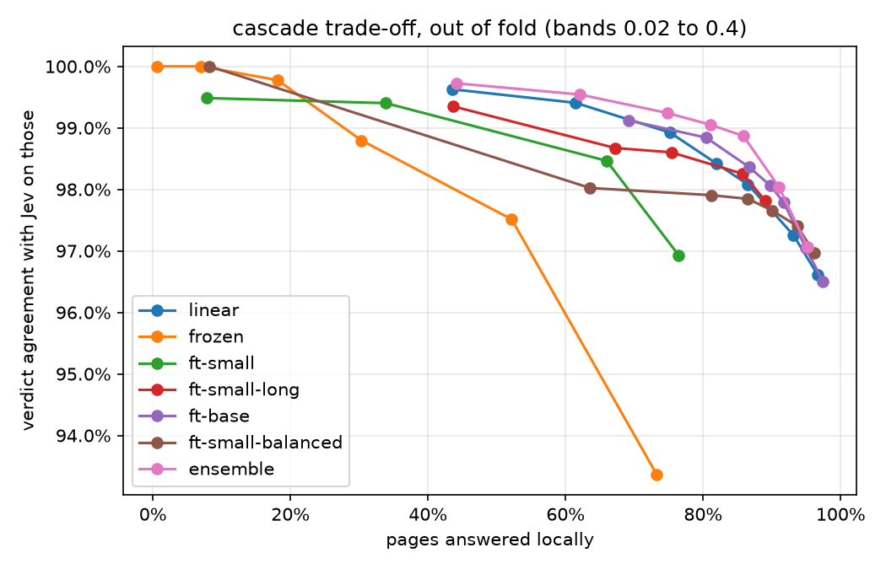

# Local page classifier

Can a local model answer the browser's `classify` presets (`isBlocked`,
`isCaptcha`, `isConsentWall`, … 12 in all) well enough to skip TypeSafe's Jev
for most pages? Every model here is a student of Jev: it learns Jev's
answers on crawled pages, and the useful measure is how many pages it can
answer **locally while still agreeing with Jev**, leaving the rest to Jev.

## Pipeline

| step | script | output |
|---|---|---|
| URL list (Tranco + seeds for rare presets) | `seeds.py`, `articles.py` | `data/urls.tsv` |
| crawl, label each page with two Jev calls | `collect.py` (`extend.py` for presets added later) | `data/pages.jsonl` |
| more rare presets: load many pages without Jev, label only the promising ones | `mine.py` | `data/pages.jsonl` |
| hand-check doubtful labels | `review.py`, `label.py` | `data/gold.jsonl` |
| linear model + browser export | `train.py`, `evaluate.py`, `export.py` | `data/model.lpcm` |
| 5 site-grouped folds | `folds.py` | `data/folds.jsonl` |
| rules + linear, out of fold | `crossval.py` | `data/oof/{rules,linear}.jsonl` |
| transformers, out of fold; final fit; ONNX | `transformer.py` (on a GPU) | `data/oof/*.jsonl`, `data/transformer*` |
| comparison | `compare.py` | `data/comparison.{txt,png}` |
| CPU scorer + timings | `score.py` | `data/costs.json` |

Labels: a preset is yes when both Jev calls score it ≥ 0.7, no when both
score it ≤ 0.3, and undecided (left out of scoring) otherwise; `gold.jsonl`
overrides Jev where it was checked by hand. With `--soft` (train.py,
crossval.py) the linear model also learns the undecided labels, at Jev's mean
score: the page counts as a positive with that weight and a negative with
the rest. Asking Jev more times would not settle them: on 744 of the 898
undecided labels both calls were in the 0.3–0.7 band, and Jev gives the same
middling score each time (the two calls differ by 0.02 at the median).

## Models

- **rules**: hand-written vendor fingerprints and phrases (`features.rules`).
- **linear**: TF-IDF over hashed word and character n-grams of what classify
  sends Jev (url, title, status, semantic tree), plus structural features
  from the HTML; one logistic regression per preset. Runs in the browser
  (`--classify-model`, `src/browser/classify_local.zig`).
- **frozen**: `multilingual-e5-small` embeddings of the whole tree, logistic
  regression on top.
- **ft-small / ft-small-long / ft-small-balanced / ft-base**: e5 encoders
  fine-tuned end to end (first 512 tokens; up to four 512-token windows;
  uncapped positive weights and 8 epochs; the 278M-parameter base model).
- **ensemble**: the mean of linear's and ft-base's calibrated scores.

## Results

### Models, on the first dataset

5-fold site-grouped cross-validation over 3,394 pages from 2,325 sites
(`compare.py`); every score comes from a model that never saw the page's
site. Agreement is on judge()'s keep-or-skip verdict, over the 2,468 pages
with every preset decided; gold is the 409 hand-checked pages.

The local columns are the most pages a model answers without Jev while
agreeing with it on at least 99.5% or 99% of them, over a fine grid of
`--sure` bands.

| model | verdict vs Jev | gold accuracy | local at 99.5% | local at 99% | CPU per page | size |
|---|---|---|---|---|---|---|
| Jev's vote | — | 91.0% | — | — | ~250 ms + network, per call | — |
| rules | 76.6% | 70.9% | — | — | — | — |
| linear | 95.4% | 84.1% | 51.7% | 69.4% | 1.8 ms (Zig) | 17 MB |
| frozen e5-small | 86.3% | 80.7% | 25.5% | 27.8% | | |
| ft-small | 88.4% | 87.5% | 24.5% | 53.3% | | |
| ft-small-long | 95.1% | 85.1% | 9.8% | 54.9% | | |
| ft-small-balanced | 96.1% | 86.3% | 8.2% | 17.7% | | |
| **ft-base** | 95.9% | 87.0% | — | 74.6% | 68 ms int8 (8 threads), 271 ms (1) | 278 MB |
| **ensemble** | 95.6% | 87.5% | **69.6%** | **81.1%** | both | both |



What the numbers say:

- **The base model is the only transformer that beats the n-grams.** It
  agrees with Jev slightly more often, is right on the hand-checked pages
  more often (87.0% vs 84.1%, against Jev's own 91.0%) and is sure of more
  pages at the same agreement. The small models, frozen or fine-tuned, are
  worse than linear for the cascade.
- **Linear and the transformer make different mistakes, so together they
  are best**: 81% of pages answered locally at 99% agreement, against 69%
  for linear alone.
- **Rare presets stay hard for every transformer.** Paywall (87 positives),
  loading (17), unsupported browser (8) and rate limits (10) have too few
  examples to fine-tune on; linear's keyword features do better on them
  (paywall F1 0.57 vs 0.44). Reading the whole tree (ft-small-long) did not
  help paywalls, so truncation is not the cause; weighting the positives up
  (ft-small-balanced) made the scores overconfident, which ruins the cascade.
- **Int8 quantization** shrinks the ONNX file from 1.1 GB to 278 MB and
  halves CPU time; it flips 0.7% of verdicts against fp32 (all from the
  matmuls: quantizing only the embeddings flips none).

### Staged cascade

Running the transformer only where linear is unsure keeps most of the gain:

| linear band, then ensemble band | answered locally | agreement | pages that run the transformer |
|---|---|---|---|
| 0.05 (linear only) | 61.5% | 99.4% | 0% |
| 0.05, then 0.10 | 76.5% | 99.1% | 38.5% |
| 0.02, then 0.15 | 81.4% | 99.0% | 56.5% |

### More data, for the linear model

`mine.py` loaded 13,400 more candidate pages (Tranco homepages past the
first 3,000, nonsense searches, members-only paths, articles from the
paywalled publishers) without asking Jev: classify with no questions and
`includeInput` returns what Jev would be sent. The linear model scored
them, and Jev was asked only about 1,500: the top 112 of each rare preset
and the ones the model was least sure of. That added 1,500 pages and
multiplied the rare positives: empty catalog 20 → 115, login wall 66 → 186,
paywall 90 → 157, loading 16 → 53, rate limited 3 → 49, unsupported
browser 6 → 22, age gate 35 → 68, region blocked 36 → 74.

Scored on the same 3,394 original pages (the new ones only train the other
folds, `compare.py --skip-source mine-`):

| | verdict vs Jev | gold accuracy | local at 99.5% | local at 99% |
|---|---|---|---|---|
| linear, first dataset | 95.4% | 84.1% | 51.7% | 69.4% |
| linear, + mined pages | 94.9% | 84.6% | 60.9% | 78.5% |
| linear, + mined pages, soft labels | 96.0% | 84.6% | 67.5% | 77.2% |
| linear, + second round | **96.8%** | **87.5%** | **68.9%** | **80.2%** |
| linear, + second round, soft labels | 96.0% | 85.8% | 67.0% | 75.0% |
| ensemble with ft-base, first dataset | 95.6% | 87.5% | 69.6% | 81.1% |

F1 against Jev per preset, same pages:

| preset | first dataset | + mined | + mined, soft | + second round |
|---|---|---|---|---|
| login wall | 0.56 | 0.60 | 0.65 | 0.63 |
| paywall | 0.57 | 0.55 | 0.58 | 0.60 |
| loading | 0.53 | 0.65 | 0.69 | 0.73 |
| age gate | 0.76 | 0.76 | 0.85 | 0.82 |
| region blocked | 0.86 | 0.91 | 0.91 | 0.91 |
| empty catalog | 0.68 | 0.70 | 0.68 | 0.72 |
| consent wall | 0.88 | 0.91 | 0.91 | 0.95 |
| blocked / captcha | 0.95 / 0.93 | 0.97 / 0.97 | 0.97 / 0.97 | 0.97 / 0.96 |

(Unsupported browser and rate limited have 8 and 10 positives among these
pages, too few to read anything into.)

A second round of `mine.py` loaded 17,000 more candidates (the next 7,000
Tranco domains, 40 articles per paywalled site) and had the retrained model
pick 1,500 more, aimed at paywalls, login walls and unsupported browsers:
paywall positives 157 → 259, login wall 186 → 313, unsupported browser
22 → 56, 6,394 pages in all. With that much data the soft labels stopped
helping: they won while the rare presets had a few dozen examples, and now
cost agreement and gold accuracy. The plain linear model matches the first
dataset's linear + transformer ensemble (87.5% on the hand-checked pages,
80% answered locally at 99% agreement) at 1.8 ms; it is what
`data/model.lpcm` now holds.

### The transformer, retrained on the new data

e5-base fine-tuned again on the 6,394 pages, same recipe, same folds as
linear (74 minutes on the Quadro RTX 5000). On the original pages:

| | verdict vs Jev | gold accuracy | local at 99.5% | local at 99% | local at 98% |
|---|---|---|---|---|---|
| linear | 96.8% | **87.5%** | **68.9%** | 80.2% | 93.4% |
| ft-base | 96.9% | 86.6% | — | — | 92.6% |
| ensemble | **97.2%** | 87.0% | 63.0% | **89.8%** | **97.2%** |
| staged: linear 0.05, then ensemble 0.15 | | | | 88.0% (transformer on 37%) | |

The data fixed the transformer's rare presets (loading 0.19 → 0.76, age
gate 0.77 → 0.89, region blocked 0.91 → 0.97, F1 against Jev), except
paywalls (0.53, linear 0.60) and empty catalogs (0.63, linear 0.72), where
keywords still win. By itself it never reaches 99% agreement on the pages
it is sure of: it is confidently wrong on a few. With linear, the ensemble
answers about 10 points more pages than linear alone at 99% agreement, as
it did on the first dataset, but none more at 99.5%.

## Recommendation

Keep the linear model in the browser and grow its data instead of adding a
transformer: 3,000 Jev-labelled pages, picked by the model itself, gained
as much as the fine-tuned base model did, at no cost per page. Paywalls
(0.60) and login walls (0.63) are still the weakest presets, and the
second round moved them less than the first moved loading and consent
walls: more rounds still help, but hand-checking those two presets'
doubtful labels (`review.py`, `label.py`) may now pay off more, since much
of what is left is Jev's own disagreement about what counts as a wall. The fine-tuned base model stays the option for a
second stage if the cascade must answer more pages locally: retrained on the
new data, it still adds about 10 points of pages at 99% agreement (80% →
88–90%), and nothing at 99.5%.

## Reproduce

```bash
uv run research/page_classifier/mine.py urls && uv run research/page_classifier/mine.py load
uv run research/page_classifier/mine.py pick --budget 1500 && uv run research/page_classifier/mine.py label  # needs TYPESAFE_API_KEY
uv run research/page_classifier/folds.py
uv run research/page_classifier/crossval.py && uv run research/page_classifier/crossval.py --soft
uv run research/page_classifier/train.py && uv run research/page_classifier/export.py
# a further round: urls --skip 7000 --seed 3, load, pick --presets is_paywall is_login_wall ..., label
# on a CUDA machine, with data/folds.jsonl and transformer.py copied over:
uv run transformer.py embed
uv run transformer.py cv --variant small        # also small-long, base
uv run transformer.py cv --variant small --epochs 8 --pos-cap 1000 --out data/oof/ft-small-balanced.jsonl
uv run transformer.py fit --variant base && uv run transformer.py export
# back here, with data/oof/*, data/transformer*.onnx and data/transformer/ copied back:
uv run research/page_classifier/score.py bench
uv run research/page_classifier/compare.py                         # or --skip-source mine-
uv run research/page_classifier/score.py page --url https://example.com   # needs TYPESAFE_API_KEY
```

On a Quadro RTX 5000, a 5-fold run takes 12 minutes for e5-small and
35 for e5-base.
